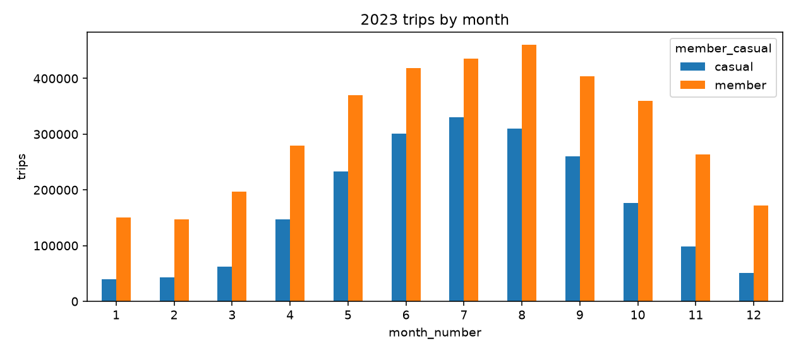
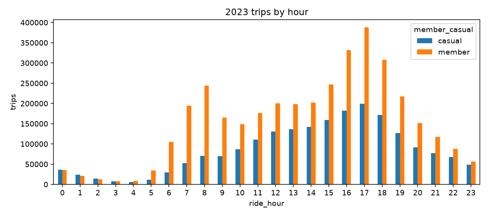
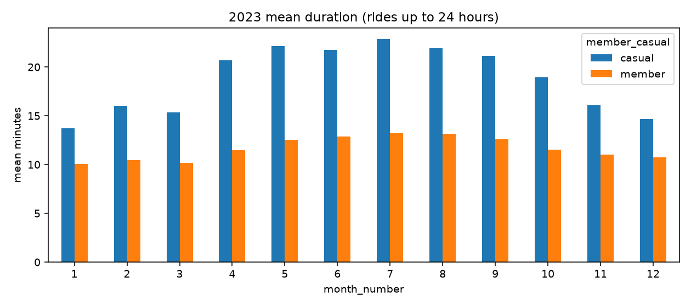
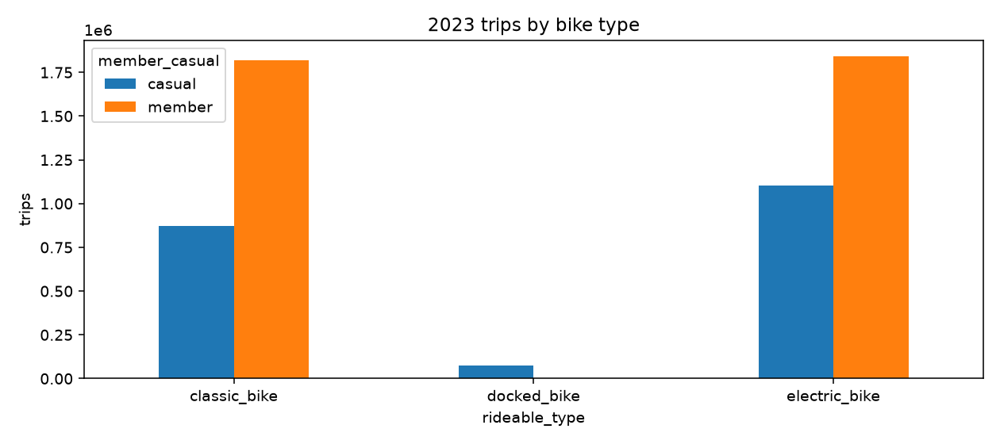
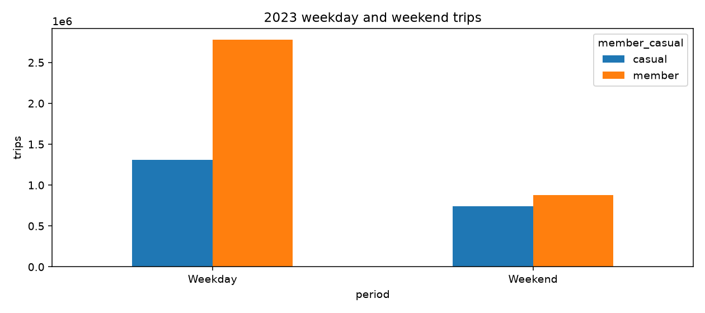

# Cyclistic bike-share analysis: 2023
Analyze annual-member and casual-rider behavior using the 12 monthly Divvy trip files for January–December 2023. The year is documented in the original presentation's source list and verified by the refreshed source files.

## Sources and refresh
[Divvy system data](https://divvybikes.com/system-data) and [monthly archive](https://divvy-tripdata.s3.amazonaws.com/index.html).
Exact monthly download URLs and archive SHA-256 hashes are in [results/sources.json](results/sources.json).
Install Python 3.12 dependencies, then run:
```bash
python -m pip install -r requirements-dev.txt
python analyze_2023.py
python -m pytest tests
```
The refresh downloads the 12 archives into ignored data/, imports the official 13-column schema into DuckDB, executes the committed cleaning SQL with a TO_CHAR compatibility adapter, and exports summary CSVs and charts.

For native PostgreSQL, start in an empty analysis database, download/extract the 12 CSVs into data/, and run from the repository root:
```bash
psql -d cyclistic -f sql_files/import_2023.psql
```
The raw table creation is separate from cleaning; no unexplained Excel ride_length/day_of_week columns are required. This import preserves the original timestamps and derives ISO weekdays (Monday=1, Sunday=7). Weekend queries use 6 and 7.

## Quality rules
The refresh imports 5,719,877 rows and unique ride IDs. It excludes 1,269 nonpositive durations and 6,418 rides longer than 24 hours, leaving 5,712,190 rides. It also excludes missing IDs/timestamps, invalid rider categories and trips starting outside 2023; these exclusions add no rows in this run. Missing station fields do not automatically discard valid rides. Duplicate IDs would keep a deterministic first record. The 24-hour cutoff is an analysis choice; long-duration sensitivity analysis is still advisable.

## Measured rider differences
| Rider | Trips | Weekend share | Mean minutes | Median minutes |
| --- | ---: | ---: | ---: | ---: |
| Casual | 2,053,358 | 36.23% | 20.70 | 11.82 |
| Member | 3,658,832 | 24.08% | 12.06 | 8.52 |

Casual riders have a higher within-group weekend share and longer median rides. These patterns support testing recreational and seasonal membership offers; they do not establish why riders travel or prove that an offer causes conversion.







All plotted counts and durations come from the refreshed cleaned dataset. [Results CSVs](results/) supply exact figures and a quality audit.

## Recommendations and limits
Test seasonal/weekend offers against a control group and measure conversion, margin and retention. Analyze stations before choosing campaign locations. Targeting repeat casual riders would require privacy-appropriate account/customer data: trip IDs do not identify repeat customers, so that recommendation is a future hypothesis rather than an analysis result.
The original PPTX and older PNGs preserve the historical case study. Its RStudio workflow and discount proposals describe earlier work; current results and methodology are the SQL/Python refresh above. Discounts require an economic test rather than an assumed savings claim. This is descriptive analysis of one calendar year, not causal or customer-level retention modeling.
